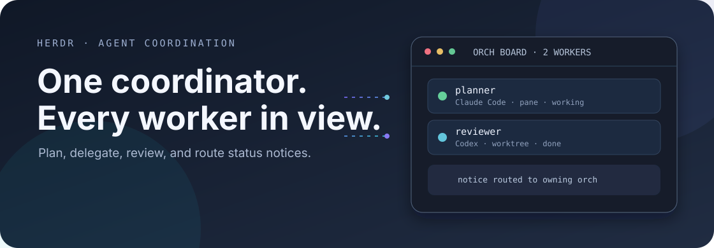

<p align="center">
  
</p>

<h1 align="center">orch</h1>

<p align="center">
  <b>Coordinate coding agents from one Herdr session.</b><br>
  Plan, delegate, review, and track workers across Claude Code and Codex.
</p>

<p align="center">
  <a href="https://github.com/smkamranqadri/orch-skill/actions/workflows/test.yml"></a>
  <a href="LICENSE"></a>
  
  
</p>

orch is a Herdr plugin and shared agent skill for coordinating coding work. It keeps an orch
registry across projects, routes worker status notices to the right coordinator, and opens a
board pane so you can see the work in flight.

## Quick start

For a release install, run this from a Herdr session:

```bash
curl -fsSL https://raw.githubusercontent.com/smkamranqadri/orch-skill/main/bootstrap.sh \
  | bash -s -- install
```

For a local checkout:

```bash
./bootstrap.sh install --source .
```

The installer requires Python 3.11 or newer and Herdr. It installs the shared skill into
`~/.agents/skills/orch`, adds Claude Code command links and Codex prompt links, places `orch` on
`~/.local/bin`, and installs or links the Herdr plugin. It uses the current `HOME` and does not
edit Herdr's config file.

Check or update the install with:

```bash
./bootstrap.sh check --source .
./bootstrap.sh update --source .
```

## Optional board keybinding

The installer prints this snippet for `prefix+b`, which opens the orch board in a full-screen
overlay:

```toml
[[keys.command]]
key = "prefix+b"
type = "plugin_action"
command = "orch.board-full"
description = "Orch board, full screen"
```

Herdr's default sidebar key is also `prefix+b`. Choose which action should own that key before
adding the snippet. The installer leaves `~/.config/herdr/config.toml` unchanged.

Run `orch board` to show the board in the current terminal. When it has no interactive terminal,
or the current pane hosts an agent, it opens the full-screen overlay. `orch board --once` renders
one frame; `orch board --width COLUMNS` sets the board width.

## What it does

- Registers Claude Code or Codex panes as orch coordinators.
- Spawns workers in panes, tabs, or dedicated Git worktrees.
- Routes each worker's done, blocked, or closed notice to its owning orch.
- Enforces one active writer per checkout and keeps failed worktree cleanup retryable.
- Shows projects, coordinators, workers, and queued notices in the board pane.
- Provides the `orch:start`, `orch:plan`, `orch:act`, `orch:close`, and `orch:model` skill commands.

Read the [orch skill](skills/orch/SKILL.md) for the workflow and command details.

## Development

```bash
git clone https://github.com/smkamranqadri/orch-skill.git
cd orch-skill
./tests/run.sh
./bootstrap.sh install --source .
```

Tests use temporary homes and a fake Herdr command. They do not install into your real home or
run an agent model. See [CONTRIBUTING.md](CONTRIBUTING.md) before proposing a change.

## Security

orch stores its registry under `${XDG_STATE_HOME:-~/.local/state}/orch/registry.json` and calls
the Herdr CLI for pane, workspace, and agent operations. It has no network service of its own.
See [SECURITY.md](SECURITY.md) to report a vulnerability.

## License

[MIT](LICENSE)
